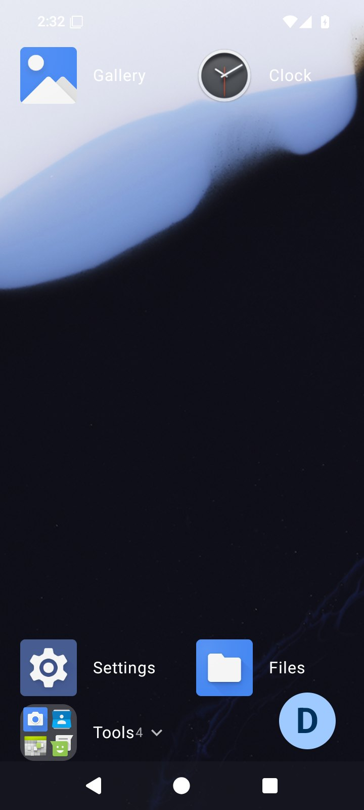
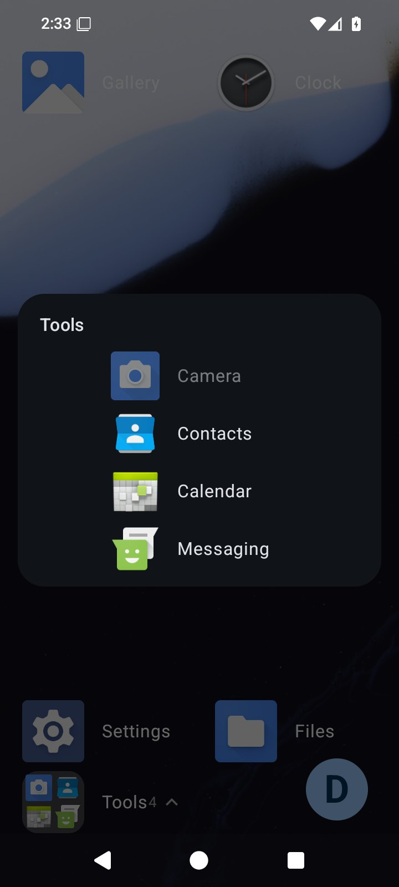
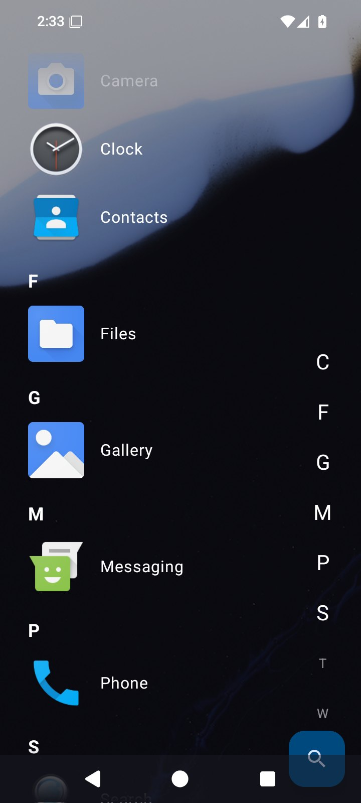
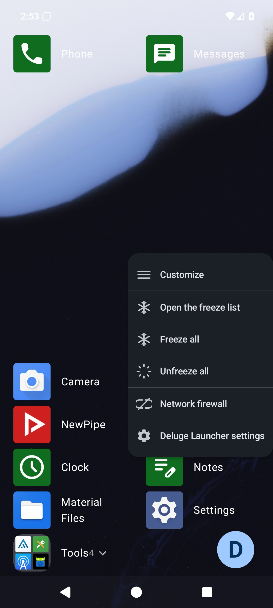
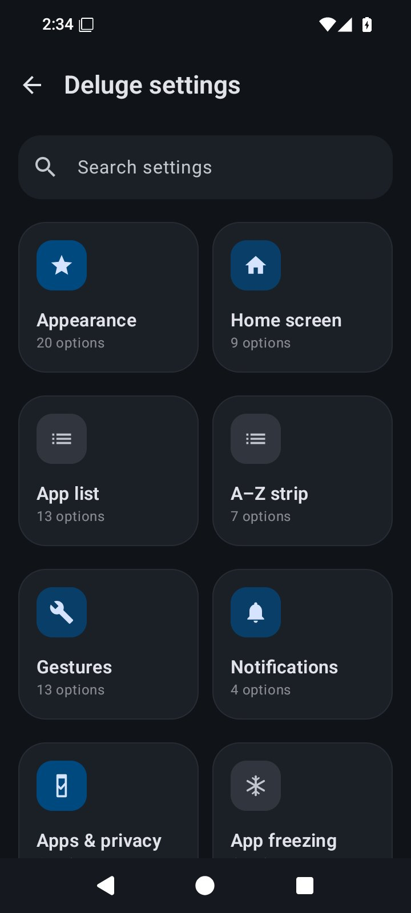
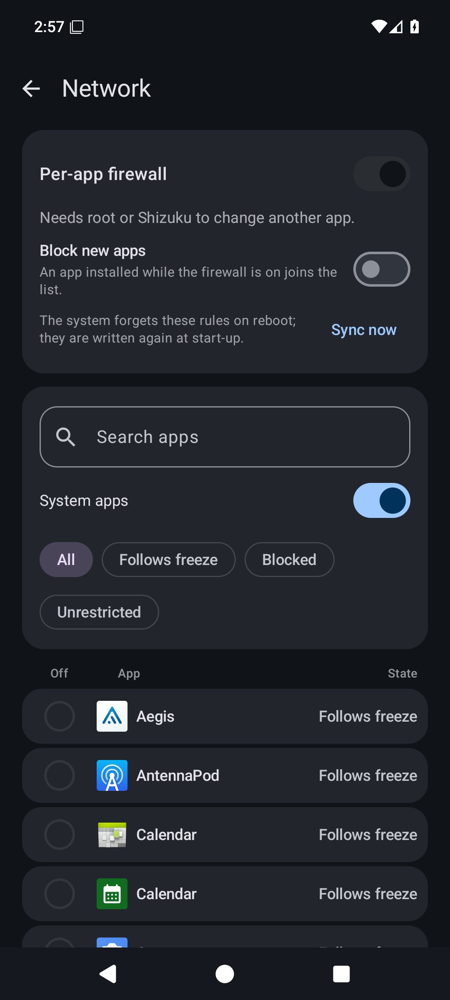
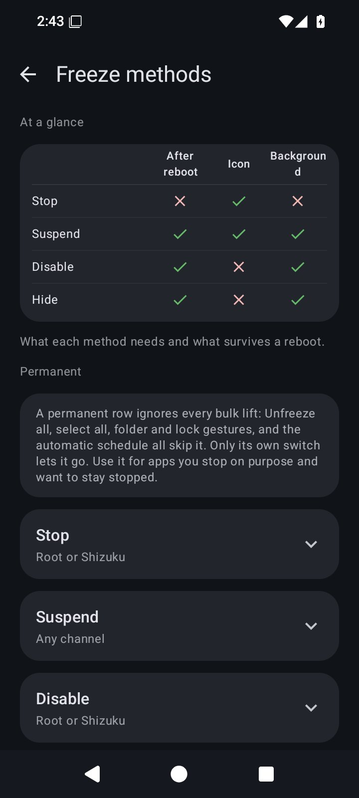

# Deluge Launcher

A minimal, list-based Android launcher that can freeze apps.

Apps are frozen from the home screen instead of from a second app with a second list to keep in
sync: a sleeping app keeps its row, folder, favorite slot and tag, drawn grey, and a tap wakes
it and opens it.

A hard fork of [Victoria Launcher](https://github.com/adelmonte/victoria-launcher) by
[adelmonte](https://github.com/adelmonte), itself an open source alternative to
[Niagara Launcher](https://niagaralauncher.app).

This fork exists for freezing, then for speed and feel: fast cold start, a thumb-reachable A-Z
strip, gestures that hold up under a real finger.

| Home | Folder, opened in two columns | App list | Long-press menu |
| ---- | ------------------------------ | -------- | --------------- |
|  |  |  |  |
| Settings | Network firewall | Freeze methods | |
|  |  |  | |

Screenshots are 720×1600, taken on an Android 16 emulator in its dark theme.

## App freezing

- **The freeze list is the home screen.** No second list to maintain, no second place to look.
- **Frozen apps keep their place.** Folders, favorite slots, names and icons survive, including
  after Disable or Hide, so nothing has to be re-added.
- **Four methods**, one tab each, with what each one breaks stated next to it: Stop, Suspend,
  Disable, Hide.
- **Permanent means it stays asleep.** Unfreeze all, a folder release, the handover exit and
  the automatic thaw all step around a permanent app, while a single tap still thaws it.
- **One table for the whole phone.** Every installed app, the method it would freeze under, and
  whether it is frozen right now; a method per app, count rows for the list, frozen and
  permanent, filters by source and state, and a comparison page for what each method survives.
- **Triggers:** freeze all, the corner button, a shortcut, or automatic freezing after the screen
  goes off — skipping the app in front, apps with notifications, and a phone on a charger.
  Unlocking thaws the list if you enable it.
- **A tap is a temporary thaw.** The row stays and the next trigger puts it back to sleep.
- **Fast by design.** One package-manager pass reads every app's state, a run only touches what
  is not already asleep, and through Shizuku each app is a single binder call — hiding included
  when the manager runs as root. A 170-app list settles in well under a second of IPC.
- **Root, Shizuku or device owner.** Shizuku is recommended and works without root (Android
  11+, over wireless debugging). Hide needs root or a device owner. A device owner needs neither:
  the same screen shows the one adb command that sets it up. The screen names what answered,
  with its version. Any manager that declares the Shizuku API is found, including Shizuku-Next
  and Shevery.
- **A paused app opened from elsewhere** gets an Unpause and open button in the system dialog
  instead of a dead end.
- **Widgets and pinned shortcuts** stay, greyed, and a tap unfreezes.
- **Protected apps** are never frozen while the guard is on (the default): the current keyboard,
  the home app, enabled accessibility services, Shizuku and every installed root manager.
- **Work profile and private space apps** can be frozen too, each profile tracked separately from
  the main one with the same package name.
- **More ways in and out:** a quick settings tile freezes or thaws the whole list, a listed app
  can pin its own toggle shortcut to the home screen, and the list can be exported to a file and
  imported on another phone.
- **System apps** are behind an off-by-default switch with a boot warning. Turning freezing off
  thaws everything first.
- **Limits:** hiding is not invisible to `MATCH_UNINSTALLED_PACKAGES`. The automatic trigger is a
  foreground service and comes back after a reboot.

## Network firewall

- **Per app, not per phone.** Three answers for a row: follow the freeze, always blocked, or
  unrestricted, so an app can be offline only while it sleeps.
- **Nothing else is touched.** An app outside the list keeps the network, and protected apps and
  the dialer are skipped whatever the list says.
- **New apps can join on their own.** With that switch on, an app installed while the firewall
  is running starts blocked.
- **Android forgets the rules on reboot**, so they are written again at start-up; the page shows
  what is applied, waiting and unconfirmed, and every row can be cleared again.
- **Uses the platform's own switch** (`set-package-networking-enabled` and chain 3), not a VPN,
  so there is no second app and no traffic leaves the phone to be filtered.

It needs root or Shizuku, and the page says so instead of pretending to work when neither is
there.

The approach follows [Hail](https://github.com/aistra0528/Hail), credited in [NOTICE](NOTICE).

## Other changes in this fork

- Faster start: icons cached on disk, icon-pack and navigation libraries removed.
- A-Z strip follows the list, highlights the letters on screen, sits opposite the list alignment
  and within thumb reach. Its letters and its scrub gestures can each be set to the left, the
  right or both sides, and the rows move aside to clear it.
- The edge touch area can be switched off entirely, so nothing on the edge opens the app list;
  a folder's members can be frozen one by one from the folder itself.
- A folder takes the whole row in the two-column layout, its name stays on one line, and its
  members open in a popup instead of pushing the screen around.
- **Per-app firewall:** cut the apps you choose off the internet, with each app following the
  freeze, staying blocked or staying online. Protected apps and the dialer are never touched,
  an app installed while it is on joins the list, and the rules are written again at start-up
  because Android forgets them on reboot.
- A row only answers a sideways swipe, so angled drags scroll instead of opening a shortcut menu.
- Apps open out of their icon and shrink back into it on a gesture back.
- Notification text under an app name in favorites, off by default: the app's newest three, each
  one opening its own notification, with a text size of its own. A dot when icons are hidden.
- Widgets can live inside a folder, above its apps, each with its own height, and a folder can
  carry the Now Playing card even when nothing is playing.
- Quick-launch swipes work along the bottom of the home screen too, and buttons inside an open
  folder keep their taps clear of the edge strip that opens the app list.
- The A-Z strip can move as a bell or a ripple, with speed, damping and stiffness, and its letter
  bubble can be rounded, circular, square or hidden.
- All home widgets can be stacked, each keeping its own height.
- Japanese app names file under kana rows, kanji under a row of their own.
- The clock widget follows the launcher's font.
- Folders file under their own names in the app list, so one is reachable by scrolling the
  alphabet; a long press manages one, adds it to the home screen or deletes it.
- Favorite rules show or hide favorites by Wi-Fi, time of day, headphones or a daily open
  limit.
- Private space apps get a padlock row at the end of the list that opens the space in place,
  installs apps into it and reaches its settings; locking an app offers the same path from
  creating the space to removing the copy outside. The freeze screen offers Android 15's
  stronger isolation when the phone has it.
- The A-Z strip's edge setting is the whole reach from the screen edge, so it leaves the icons alone.
- Pinyin search by initials or full spelling, and pinyin ordering for Chinese app names.
- Tags with scrubbing, and a Frequent tag that follows usage.
- Per-app lock, uninstall and hide from the long-press menu.
- Full-bleed lists, one or two columns, in either orientation.
- Corner button with more than ten actions; the favorites swipes offer the same list.
- Widget height follows the widget unless set by hand; frozen widgets are not cleaned away.
- Night dark theme, wallpaper blur, pinch-to-resize icons, reduced motion, custom night hours.
- Two-column settings with search over every row, localized changelog, Back to the section it
  came from.
- Settings → About → check for updates reads the release page. That read is the app's only
  network call and sends nothing.

## Install

Android 8.0 (API 26) or newer. Freezing needs root (Magisk, KernelSU or APatch),
[Shizuku](https://shizuku.rikka.app/), or Deluge set as the device owner (Settings → Freezing
access shows the adb command). The network firewall needs root or Shizuku; a device owner can
freeze apps but cannot write those rules.

Pick Deluge Launcher under **Settings → Apps → Default apps → Home app**.

The home screen starts empty on purpose: long-press the wallpaper for favorites, widgets, edit
layout and settings; swipe in from either edge for the A-Z list; long-press any app to rename,
re-icon, tag, lock, freeze, hide, uninstall or file it into a folder.

Double-tap-to-lock on the A-Z strip needs the accessibility service; the toggle stays greyed
until restricted settings are allowed from App info. **Export settings** covers every setting,
the language and the pinned shortcuts; the freeze list and what is frozen stay on the device.
Work profiles are picked up automatically; a private space needs Android 15+ and Deluge as the
default home app.

## Build

JDK 17 and an Android SDK with platform 37 (versions are the `baseline.*` keys in
`gradle.properties`).

```sh
./gradlew assembleDebug
```

Release builds need your own signing key; see [docs/CONTRIBUTING.md](docs/CONTRIBUTING.md) for build
notes and [docs/ARCHITECTURE.md](docs/ARCHITECTURE.md) for the code layout.

## Credits and license

Forked from **Victoria Launcher** by adelmonte (https://github.com/adelmonte/victoria-launcher),
whose architecture and code this builds on. The freezing model follows **Hail** by aistra0528;
the privilege layer is **Shizuku**. Both are named in [NOTICE](NOTICE).

GNU General Public License v3.0 or later — see [LICENSE](LICENSE).

Not affiliated with Victoria Launcher, Niagara Launcher or their authors; those names only say
where this came from and what it is an alternative to.
