# Deluge Launcher

**A minimal, list-based Android launcher that can freeze apps.**

The usual way to freeze an app on Android is a separate app standing beside your launcher,
with a list of its own to keep in sync. Deluge does it from the home screen: an
app you put to sleep keeps its row, its folder, its favorite slot and its tag, drawn grey,
and a tap wakes it and opens it. As far as we can tell, it is the first launcher to build
freezing in.

It is a hard fork of [Victoria Launcher](https://github.com/adelmonte/victoria-launcher) by
[adelmonte](https://github.com/adelmonte) — itself an open source alternative to
[Niagara Launcher](https://niagaralauncher.app).

**What this fork is for: freezing, and then speed and feel.** Freezing is the reason to
pick this over any other list launcher; below it are the same reasons to keep it — a fast
cold start, a thumb-reachable A-Z strip, gestures that behave under a real finger.

| App freezing | Home | App list | Long-press menu |
| ------------ | ---- | -------- | --------------- |
| 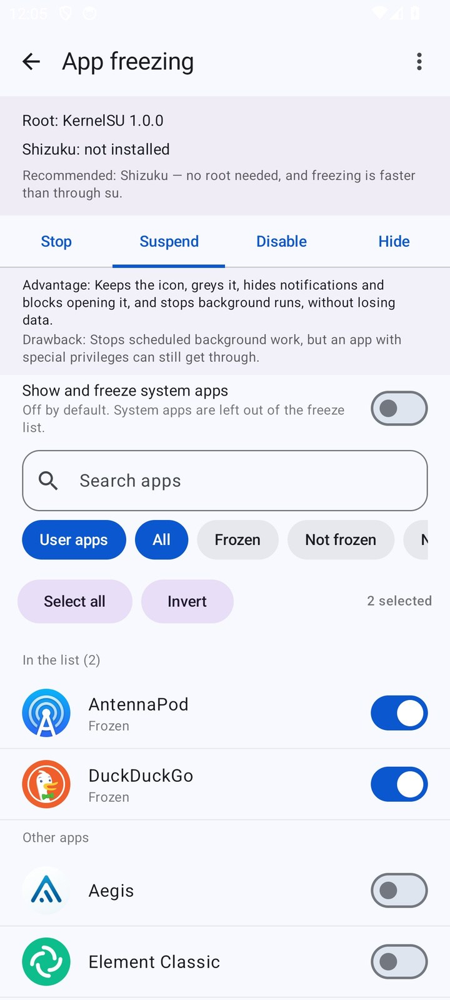 | 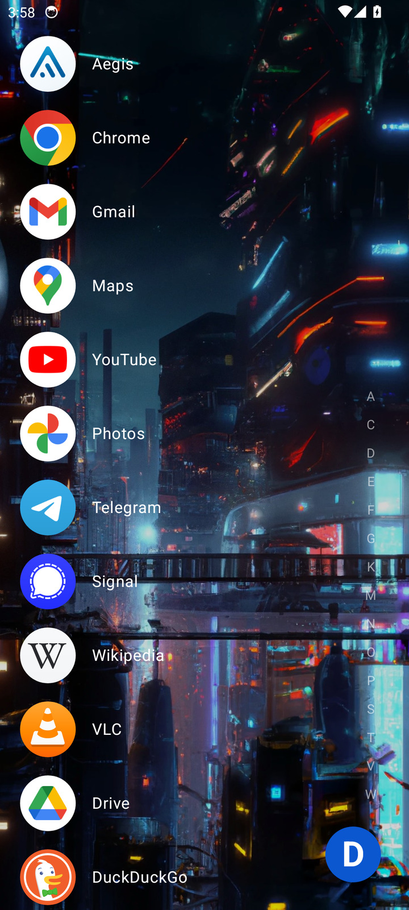 | 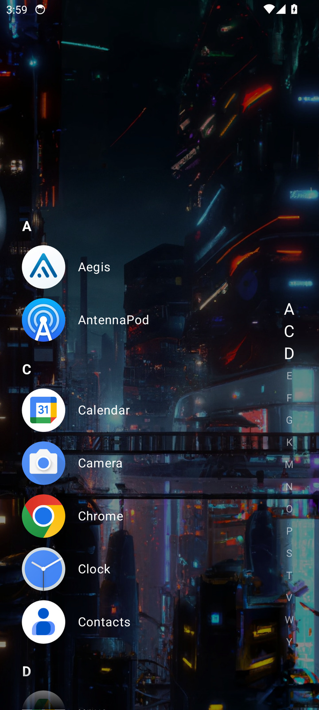 | 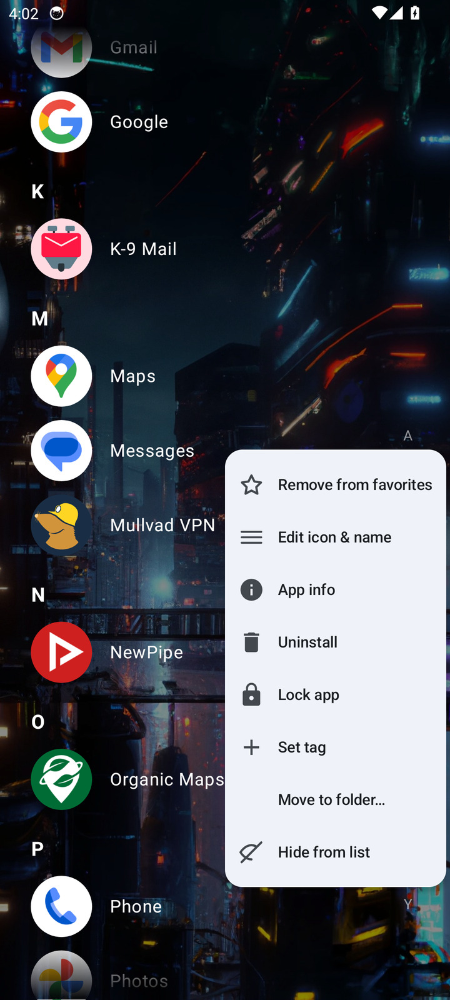 |
| Folder | Search | Edit layout | Scrubbing the A-Z strip |
| 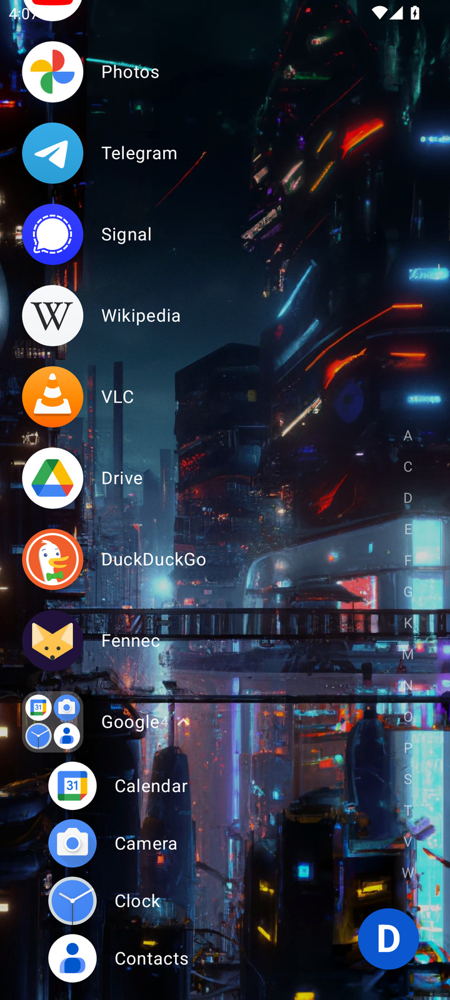 | 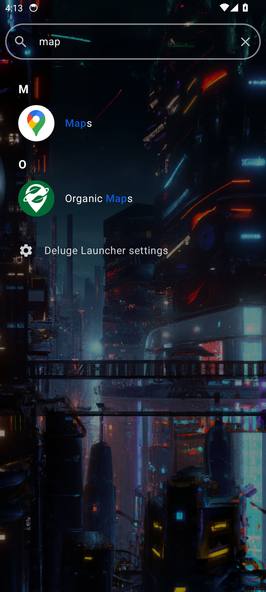 | 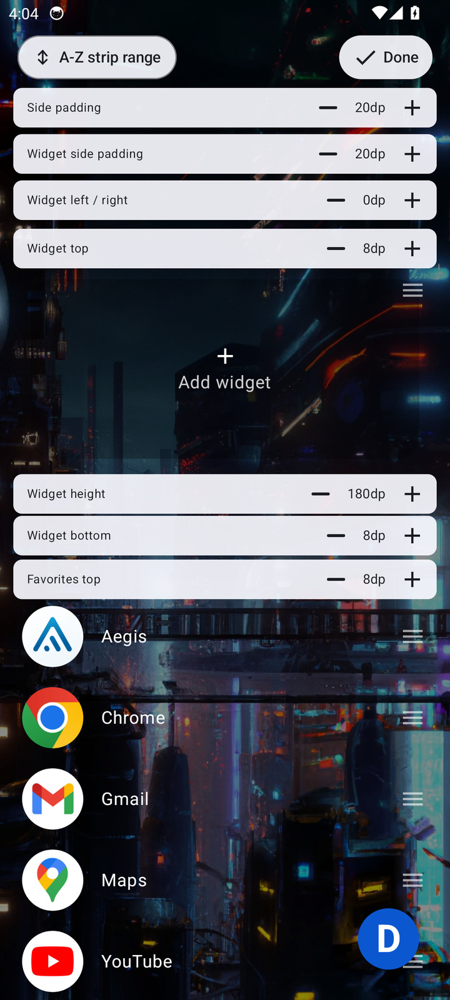 | 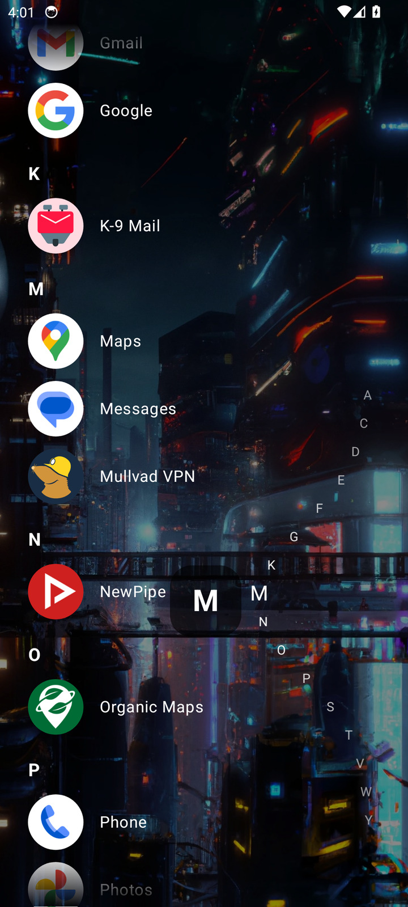 |
| Edit icon & name | Settings | Gestures | Corner button |
| 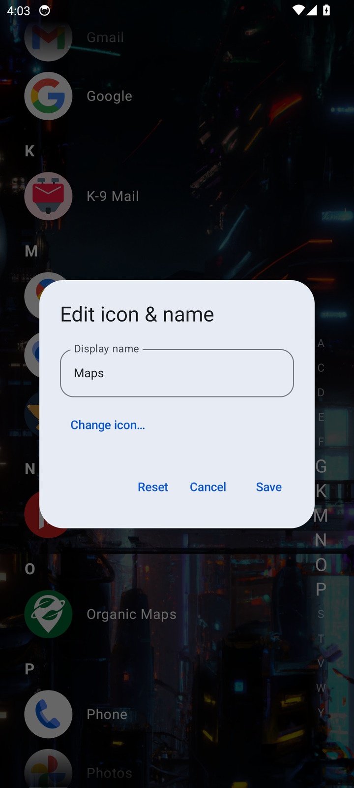 | 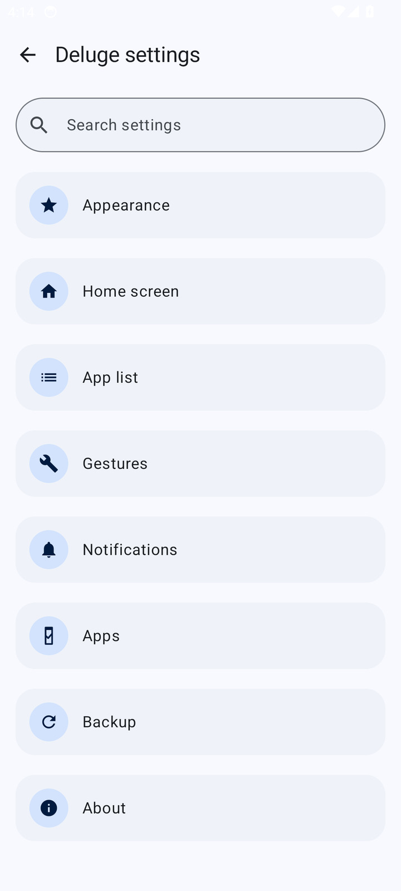 | 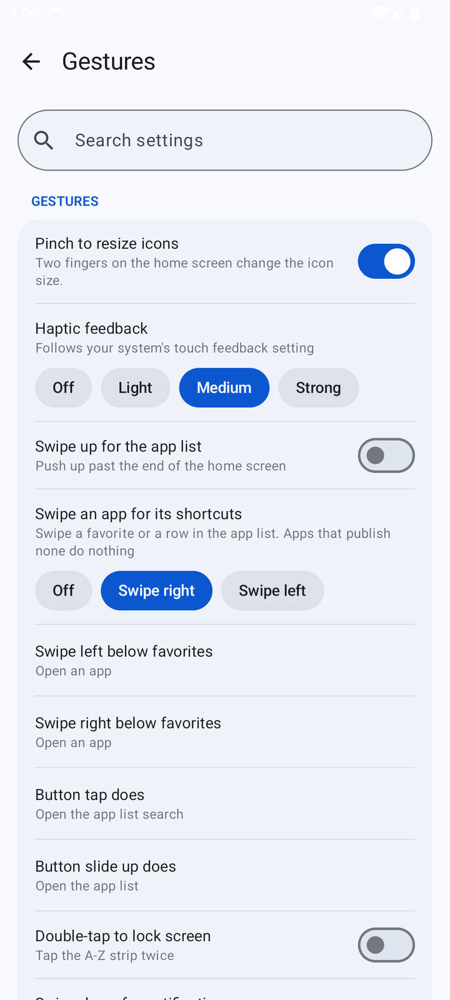 | 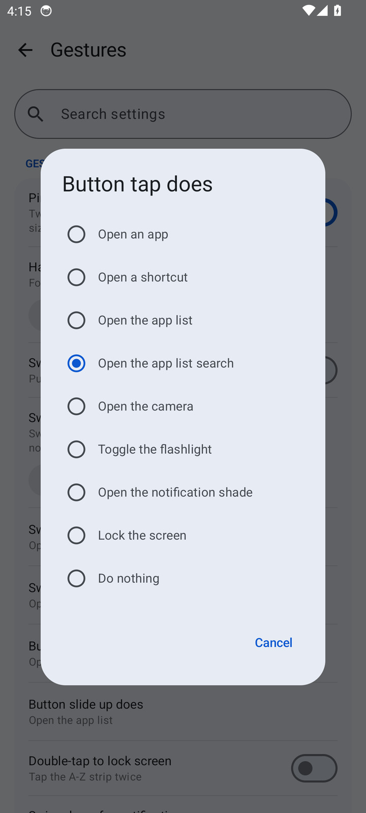 |

Taken on an Android 14 emulator at 1080×2400. Wallpaper: *Dystopian cyberpunk city* by
Matankic (DALL·E) — [CC BY-SA 4.0](https://creativecommons.org/licenses/by-sa/4.0), via
Wikimedia Commons.

## Freezing, inside the launcher

- **One list, not two.** A freezer app means a second list of apps to maintain, and a
  second place to look when you cannot remember what you put to sleep. Here the freeze list
  *is* the home screen: the same rows, folders and tags you already have, with the sleeping
  ones greyed. Tap one and it wakes and opens — no detour through another app.
- **Frozen apps never leave their place.** Even Disable and Hide — the methods that remove
  an app from every other launcher — keep their row here, in the same folder and favorite
  slot, with the same name and icon. Nothing to re-add when it comes back.
- **Four ways to sleep, with the cost written next to each.** Stop kills the app now and
  keeps nothing frozen; Suspend greys it, hides its notifications, closes whatever it had
  open and takes away its background jobs; Disable switches it off and drops it out of the
  launcher while Settings still lists it; Hide removes it from the launcher and Settings
  both. One tab per method, each saying what it does and what it breaks.
- **A trigger, not a switch.** Build the list once, then: freeze all, the corner button, a
  shortcut on the launcher's own icon, or automatic freezing a while after the screen goes
  off. The automatic one steps around the app in front of you, apps with notifications, and
  a phone on a charger — read through root or Shizuku, not by asking for more permissions.
  Unlock and the list thaws again, if you want it to.
- **A tap is a temporary thaw.** Unfreezing to open an app does not take it off the list: the row stays, and the next trigger puts it back to sleep. Select all and invert fill or empty the list in one go; the long-press menu does it a row at a time.
- **Fast enough to be a gesture.** Commands are batched and run in parallel `su` sessions —
  a freeze of a 170-app list takes a few seconds, and a second run does almost nothing
  because the apps already asleep are skipped.
- **Root or Shizuku, whichever you have.** Both work; Shizuku is the recommended one and the
  faster one, and it is also the only option without root (over wireless debugging, Android
  11 and up). Hide is the exception and needs root. The screen names what is answering —
  Magisk, KernelSU or APatch with its version, or Shizuku with its version — so a refusal is
  never a mystery.
- **Widgets and pinned shortcuts are part of it.** A frozen app's widget or shortcut stays
  on the screen, greyed rather than cleaned away; tapping one unfreezes the app and opens it,
  the same as tapping its row.
- **System apps are behind a switch that warns you.** Off by default, with the honest
  warning about a phone that will not boot afterwards. Turning freezing off thaws everything
  first, so there is no half-frozen state left behind.
- **What it does not claim.** Hiding is hidden from launchers and Settings, not from an app
  that deliberately enumerates with `MATCH_UNINSTALLED_PACKAGES`; no on-device freezer can
  promise more than that. Frozen apps survive a reboot, but the automatic trigger runs while
  the launcher is alive, so open it once after a reboot. The feature needs root or Shizuku
  to do anything at all.

The approach follows [Hail](https://github.com/aistra0528/Hail), credited in [NOTICE](NOTICE).

## Everything else this fork changes

- **Faster to open.** Icons are cached on disk, so the second launch reads bytes instead
  of drawing pictures, and two large libraries are gone: the icons pack and the
  navigation library.
- **The A-Z strip is a thumb control.** It follows the list as you scroll, highlights
  every letter on screen, sits on the side the list is not aligned to, and rests in the
  lower half so reaching a letter never means moving the whole hand.
- **Scrolling is never stolen.** A row only answers a sideways swipe, so a drag that
  started at an angle scrolls the list instead of opening a shortcut menu. Overscrolling
  the bottom springs back instead of closing the list.
- **Search speaks pinyin.** Initials and full spelling both find the app, with the match
  sits under Z, not under the A of its English name — here, in the pickers, and in settings.
- **Tags across the alphabet.** Group apps by what they are for, scrub them from the
  strip, and let the Frequent tag follow usage on its own.
- **A lock per app.** Opening one asks for the screen lock; the long-press menu also
  uninstalls, hides with confirmation, and paused apps grey out live.
- **Favorites reach the edge.** The home list runs full-bleed like the app list and
  scrolls fully into view. Either one can pair rows into two columns, upright or sideways.
- Folder rows say how many apps they hold and whether they are open.
- **A corner button with more than ten actions.** Tap it, or hold and slide up; each gesture
  opens an app or a shortcut, the list, search, the camera, the flashlight, the
  shade, locks the screen, freezes or unfreezes the freeze list, or does nothing — and the
  button parks in any corner. The swipes under the favorites offer the same list, one per side.
- Widget height follows the widget itself, unless you set it by hand. Widgets refresh
  when their app freezes and unfreezes, and a frozen one is never cleaned away.
- Night dark theme, wallpaper blur, pinch-to-resize icons, reduced motion. Auto-dark
  follows custom night hours you set yourself.
- Settings is a two-column grid with a search box over every row, a changelog that follows the
  language, and Back that returns to the section it came from. A restored backup re-pins the
  shortcuts it names and covers every setting including the language.
- **Settings → About checks for updates.** It reads the release page to see whether a newer
  version exists and points you at it. That read is the app's only network call, and it
  sends nothing — no setting, no app list, no usage.

The in-app changelog (Settings → About → Changelog) has the release-by-release
list.

## Install

Requires Android 8.0 (API 26) or newer. Freezing needs root (Magisk, KernelSU or APatch) or
[Shizuku](https://shizuku.rikka.app/) — Shizuku alone is enough, no root needed.

Once it is installed, pick Deluge Launcher under **Settings → Apps → Default apps → Home
app**.

## Getting started

The home screen starts almost empty on purpose — everything on it is put there by you.

- **Long-press the wallpaper** for the menu: favorites, widgets, edit layout, settings.
- **Swipe in from either edge** for the A-Z list, then slide along the letters to jump to
  one. Tap the edge and let go to just open it.
- **Long-press any app**, on either screen, to rename it, change its icon, tag it,
  lock it, freeze it, hide it, uninstall it, or file it in a folder.
- **Settings → Apps → App freezing** builds the freeze list and owns its triggers. Adding an
  app only adds it to the list; a trigger does the freezing. A frozen app sits greyed in its
  usual place — tap it to wake it and open it.
- **Edit layout** gives you drag handles for the order and steppers for every gap, height
  and margin.

Everything else lives in Settings, which has a search box over the whole of it.

Two things are worth knowing. Double-tapping the A-Z strip to lock the screen needs an
accessibility service, and if that toggle is greyed out you have to allow restricted
settings from App info first — Android blocks it for anything installed outside a store.
And **Export settings** is how you keep your setup: it covers every setting, the language,
and re-pins the shortcuts it names when you import it. The freeze list and what is currently
frozen stay with the device and are not exported with it.

Work profiles are picked up automatically. A private space needs Android 15 or later and
Deluge set as your default home app.

## Build

You need JDK 17 and an Android SDK with platform 37 (the exact versions are the
`baseline.*` keys in `gradle.properties`).

```sh
./gradlew assembleDebug
```

A release build is signed from a git-ignored `keystore.properties`:

```properties
storeFile=app/keys_release.jks
storePassword=***
keyAlias=deluge
keyPassword=***
```

Without it, `assembleRelease` produces an **unsigned** APK (it prints a warning) — that is
deliberate, and it must not be published. See [fdroid/README.md](fdroid/README.md) for the
signing key, the release checklist and the F-Droid / IzzyOnDroid situation.

Translations are welcome — see [TRANSLATING.md](docs/TRANSLATING.md).
[CONTRIBUTING.md](docs/CONTRIBUTING.md) has the full build notes, and
[ARCHITECTURE.md](docs/ARCHITECTURE.md) how the code fits together.

## Credits and license

Forked from **Victoria Launcher** by adelmonte
(https://github.com/adelmonte/victoria-launcher), which this project could not exist
without. The original architecture, most of the code and much of the explanatory
commentary are theirs. The freezing model follows **Hail** by aistra0528, and the privilege
layer is **Shizuku**; both are named in [NOTICE](NOTICE).

Licensed under the **GNU General Public License v3.0 or later** — see [LICENSE](LICENSE).
As a modified version of the original work, the same license applies to it: the source is
here, complete, and the changes are recorded in the git history and in [NOTICE](NOTICE).

This project is **not affiliated with Victoria Launcher, Niagara Launcher, or their
authors**. "Victoria Launcher" and "Niagara Launcher" are named only to say where this came
from and what it is an alternative to.
