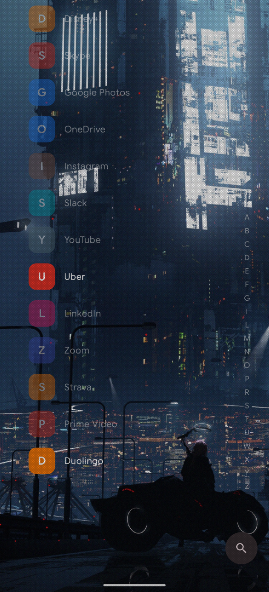
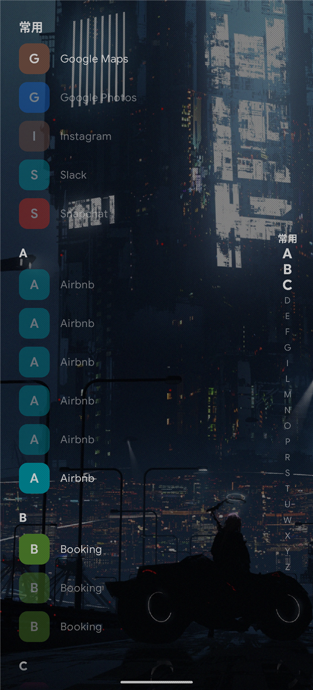
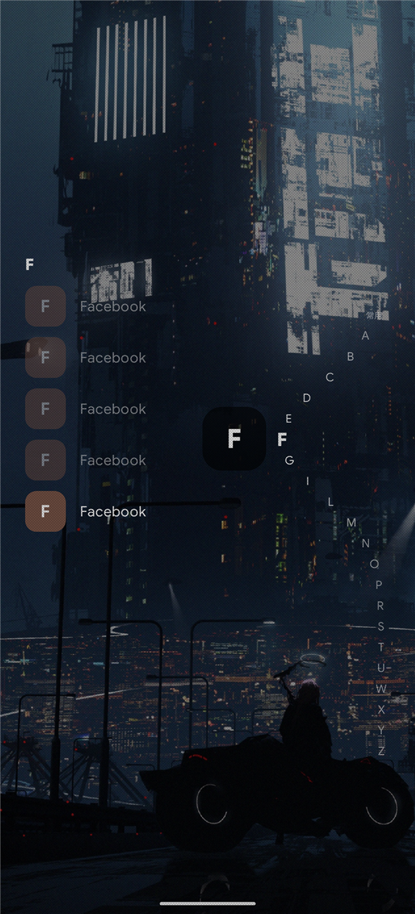
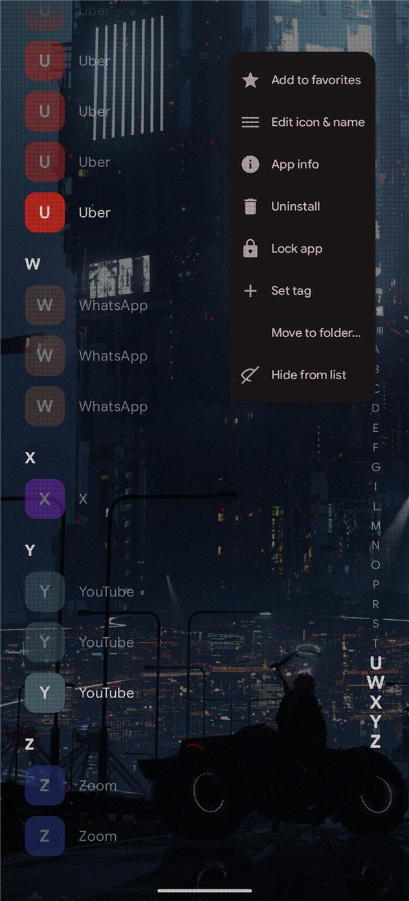

# Deluge Launcher

A minimal, list-based Android home screen, and a hard fork of
[Victoria Launcher](https://github.com/adelmonte/victoria-launcher) by
[adelmonte](https://github.com/adelmonte) — itself an open source alternative to
[Niagara Launcher](https://niagaralauncher.app).

**What this fork is for: speed and feel.** It is tuned for a fast cold start and for
reaching the app list and a letter with one thumb — icons cached on disk, unneeded
dependencies dropped, and the A-Z strip, edge gestures and row swipes made to behave
under a real finger. Everything else is upstream's design, kept as it was.

## What this fork changes

- **Faster to open.** Icons are cached on disk, so the second launch reads bytes instead
  of drawing pictures, and two large libraries are gone: the icons pack and the
  navigation library.
- **The A-Z strip is a thumb control.** It follows the list as you scroll, highlights
  every letter on screen, sits on the side the list is not aligned to, and rests in the
  lower half so reaching a letter never means moving the whole hand.
- **Scrolling is never stolen.** A row only answers a sideways swipe, so a drag that
  started at an angle scrolls the list instead of opening a shortcut menu. Overscrolling
  the bottom springs back instead of closing the list.
- **Search speaks pinyin.** Initials and full spelling both find the app, with the match
  highlighted.
- **Tags across the alphabet.** Group apps by what they are for, scrub them from the
  strip, and let the Frequent tag follow usage on its own.
- **A lock per app.** Opening one asks for the screen lock; the long-press menu also
  uninstalls, hides with confirmation, and paused apps grey out live.
- **Favorites reach the edge.** The home list runs full-bleed like the app list and
  scrolls fully into view.
- Folder rows say how many apps they hold and whether they are open.
- Widget height follows the widget itself, unless you set it by hand. Widgets refresh
  when their app freezes and unfreezes, and a frozen one is never cleaned away.
- Night dark theme, wallpaper blur, pinch-to-resize icons, reduced motion.
- Settings has a changelog that follows the language, every row is searchable, and Back
  returns to the section it came from. A restored backup re-pins the shortcuts it names
  and covers every setting including the language.

Plus a number of smaller fixes and additions along the way. The in-app changelog
(Settings → About → Changelog) has the release-by-release list.

## Screenshots

| Home | App list |
| ---- | -------- |
|  |  |

| Scrubbing | Long-press menu |
| --------- | --------------- |
|  |  |

## Install

Requires Android 8.0 (API 26) or newer.

Once it is installed, pick Deluge Launcher under **Settings → Apps → Default apps → Home
app**.

## Getting started

The home screen starts almost empty on purpose — everything on it is put there by you.

- **Long-press the wallpaper** for the menu: favorites, widgets, edit layout, settings.
- **Swipe in from either edge** for the A-Z list, then slide along the letters to jump to
  one. Tap the edge and let go to just open it.
- **Long-press any app**, on either screen, to rename it, change its icon, tag it,
  lock it, hide it, uninstall it, or file it in a folder.
- **Edit layout** gives you drag handles for the order and steppers for every gap, height
  and margin.

Everything else lives in Settings, which has a search box over the whole of it.

Two things are worth knowing. Double-tapping the A-Z strip to lock the screen needs an
accessibility service, and if that toggle is greyed out you have to allow restricted
settings from App info first — Android blocks it for anything installed outside a store.
And **Export settings** is how you keep your setup.

Work profiles are picked up automatically. A private space needs Android 15 or later and
Deluge set as your default home app.

## Build

You need JDK 17 and an Android SDK with platform 35.

```sh
./gradlew assembleDebug
```

Translations are welcome — see [TRANSLATING.md](docs/TRANSLATING.md).
[CONTRIBUTING.md](docs/CONTRIBUTING.md) has the full build notes, and
[ARCHITECTURE.md](docs/ARCHITECTURE.md) how the code fits together.

## Credits and license

Forked from **Victoria Launcher** by adelmonte
(https://github.com/adelmonte/victoria-launcher), which this project could not exist
without. The original architecture, most of the code and much of the explanatory
commentary are theirs.

Licensed under the **GNU General Public License v3.0 or later** — see [LICENSE](LICENSE).
As a modified version of the original work, the same license applies to it: the source is
here, complete, and the changes are recorded in the git history and in [NOTICE](NOTICE).

This project is **not affiliated with Victoria Launcher, Niagara Launcher, or their
authors**. "Victoria Launcher" and "Niagara Launcher" are named only to say where this
came from and what it is an alternative to.
